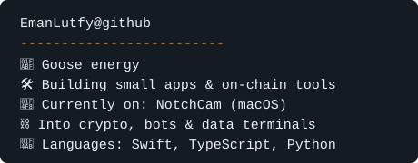

  

 

  
  

<h2 align="center"> Now Building </h2>

<table>
  <tr>
    <td valign="top" width="100%">
      <h3> 𝗡𝗼𝘁𝗰𝗵𝗖𝗮𝗺</h3>
      

        An instant camera that lives in your MacBook notch. Snap a photo and it
        prints out of the notch like a polaroid.
      

      

        
        
        
      

      
<i> In progress, coming soon.</i>

    </td>
  </tr>
</table>

<h2 align="center"> Other Repo </h2>

<table>
  <tr>
    <td valign="top">
      <h3> 𝗢𝗻-𝗰𝗵𝗮𝗶𝗻</h3>
      <ul>
        <li><a href="https://github.com/EmanLutfy/nft-public-mint">𝐧𝐟𝐭-𝐩𝐮𝐛𝐥𝐢𝐜-𝐦𝐢𝐧𝐭</a>: CLI for public SeaDrop NFT mints</li>
        <li><a href="https://github.com/EmanLutfy/fomo-api">𝐟𝐨𝐦𝐨-𝐚𝐩𝐢</a>: backend for an on-chain data terminal</li>
        <li><a href="https://github.com/EmanLutfy/seal">𝐬𝐞𝐚𝐥</a>: Wal Seal, in Rust</li>
      </ul>
    </td>
    <td valign="top">
      <h3> 𝗕𝗼𝘁𝘀 & 𝗳𝘂𝗻</h3>
      <ul>
        <li><a href="https://github.com/EmanLutfy/bottwiiter">𝐛𝐨𝐭𝐭𝐰𝐢𝐢𝐭𝐞𝐫</a>: X / Twitter bot</li>
        <li><a href="https://github.com/EmanLutfy/twitscrapper">𝐭𝐰𝐢𝐭𝐬𝐜𝐫𝐚𝐩𝐩𝐞𝐫</a>: X / Twitter scraper</li>
        <li><a href="https://github.com/EmanLutfy/Shrimpers-Snake">𝐒𝐡𝐫𝐢𝐦𝐩𝐞𝐫𝐬-𝐒𝐧𝐚𝐤𝐞</a>: classic snake, but shrimp</li>
        <li><a href="https://github.com/EmanLutfy/palette-gen">𝐩𝐚𝐥𝐞𝐭𝐭𝐞-𝐠𝐞𝐧</a>: colour palette generator</li>
      </ul>
    </td>
  </tr>
</table>

<h2> GitHub Analytics</h2>

 

  
  

  

  

