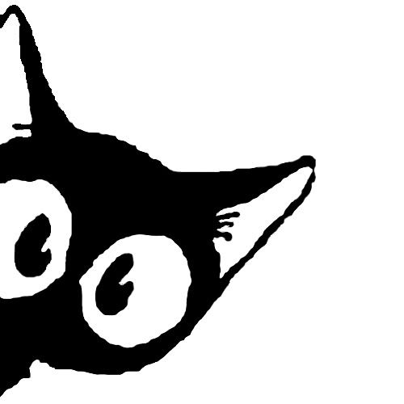
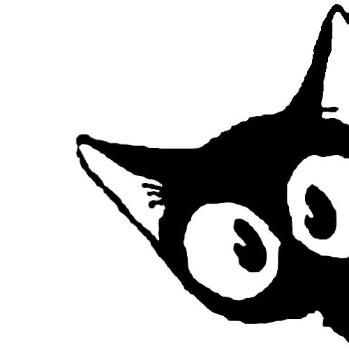

[](https://git.io/typing-svg)

<p align="center">
  
</p> <br>

<p>


```
EmanLutfy@github
-------------------------
🪿 Goose energy
🛠️ Building small apps & on-chain tools
📸 Currently on: NotchCam (macOS)
⛓️ Into crypto, bots & data terminals
💫 Languages: Swift, TypeScript, Python
```
</p>

<br clear="left"/>

<h2 align="center"> 🇳‌🇴‌🇼‌ 🇧‌🇺‌🇮‌🇱‌🇩‌🇮‌🇳‌🇬‌ </h2>

<table>
  <tr>
    <td valign="top" width="100%">
      <h3>📸 𝗡𝗼𝘁𝗰𝗵𝗖𝗮𝗺</h3>
      <p>
        An instant camera that lives in your MacBook notch. Snap a photo and it
        prints out of the notch like a polaroid.
      </p>
      <p>
        
        
        
      </p>
      <p><i>🚧 In progress, coming soon.</i></p>
    </td>
  </tr>
</table>

<h2 align="center"> 🇴‌🇹‌🇭‌🇪‌🇷‌ 🇷‌🇪‌🇵‌🇴‌🇸‌ </h2>

<table>
  <tr>
    <td valign="top">
      <h3>⛓️ 𝗢𝗻-𝗰𝗵𝗮𝗶𝗻</h3>
      <ul>
        <li><a href="https://github.com/EmanLutfy/nft-public-mint">𝐧𝐟𝐭-𝐩𝐮𝐛𝐥𝐢𝐜-𝐦𝐢𝐧𝐭</a>: CLI for public SeaDrop NFT mints</li>
        <li><a href="https://github.com/EmanLutfy/fomo-api">𝐟𝐨𝐦𝐨-𝐚𝐩𝐢</a>: backend for an on-chain data terminal</li>
        <li><a href="https://github.com/EmanLutfy/seal">𝐬𝐞𝐚𝐥</a>: Wal Seal, in Rust</li>
      </ul>
    </td>
    <td valign="top">
      <h3>🤖 𝗕𝗼𝘁𝘀 & 𝗳𝘂𝗻</h3>
      <ul>
        <li><a href="https://github.com/EmanLutfy/bottwiiter">𝐛𝐨𝐭𝐭𝐰𝐢𝐢𝐭𝐞𝐫</a>: X / Twitter bot</li>
        <li><a href="https://github.com/EmanLutfy/twitscrapper">𝐭𝐰𝐢𝐭𝐬𝐜𝐫𝐚𝐩𝐩𝐞𝐫</a>: X / Twitter scraper</li>
        <li><a href="https://github.com/EmanLutfy/Shrimpers-Snake">𝐒𝐡𝐫𝐢𝐦𝐩𝐞𝐫𝐬-𝐒𝐧𝐚𝐤𝐞</a>: classic snake, but shrimp</li>
        <li><a href="https://github.com/EmanLutfy/palette-gen">𝐩𝐚𝐥𝐞𝐭𝐭𝐞-𝐠𝐞𝐧</a>: colour palette generator</li>
      </ul>
    </td>
  </tr>
</table>

<h2 align="center"> 🇨‌🇴‌🇳‌🇹‌🇦‌🇨‌🇹‌ 🇲‌🇪‌ </h2>


<br>

<p align="center">
  𝙵𝚎𝚎𝚕 𝚏𝚛𝚎𝚎 𝚝𝚘 𝚛𝚎𝚊𝚌𝚑 𝚘𝚞𝚝 🪿
  <br>
  𝙸 𝚖𝚒𝚐𝚑𝚝 𝚑𝚘𝚗𝚔 𝚋𝚊𝚌𝚔 𝚕𝚊𝚝𝚎, 𝚋𝚞𝚝 𝙸 𝚠𝚒𝚕𝚕 𝚑𝚘𝚗𝚔 𝚋𝚊𝚌𝚔
  <br>
  <br>
</p>

<p align="center">
<a href="https://github.com/EmanLutfy" target="_blank">
  
</a>
</p>

<p align="center">
  
</p>
